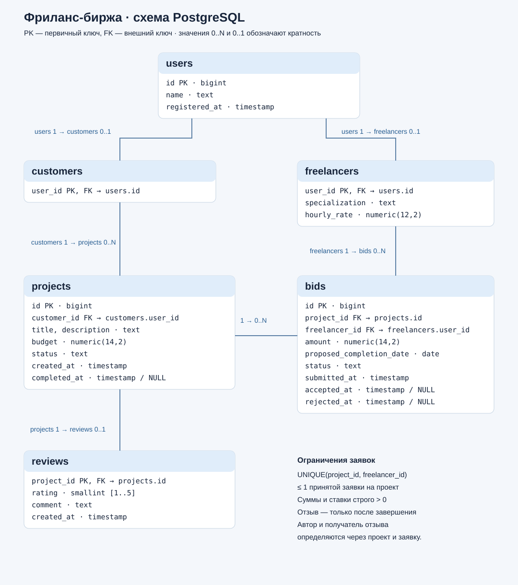

# SQL-тренажёр: PostgreSQL, 50 задач и автопроверка

Запуск одной командой. Нужен только работающий Docker Desktop (Windows/macOS) или Docker Engine (Linux). Python, PostgreSQL и IDE на компьютере не требуются.

```bash
docker run --rm -it --name sqltrainee -p 127.0.0.1:8888:8888 -v sqltrainee-data:/var/lib/sqltrainee ghcr.io/dredward-chell/sqltrainee:latest
```

Первый запуск скачает образ и подготовит базу. В терминале появится ссылка вида `http://127.0.0.1:8888/lab/tree/training.ipynb?token=...`. Открой **полную ссылку**: случайный токен защищает доступ к notebook. Команда подходит и для PowerShell, если вставить ее одной строкой. Intel/AMD и Apple Silicon поддерживаются отдельными вариантами образа.

**Остановка:** Ctrl+C. **Продолжить:** снова та же команда. Именованный том `sqltrainee-data` хранит notebooks, ответы, прогресс и базу даже после удаления контейнера. Не удаляй этот том, если хочешь сохранить решения. Контейнер рассчитан на одного учащегося на его компьютере.

## Как решать

1. Открой `training.ipynb` и выполни первую ячейку `from trainer import *; install()`.
2. В ячейке задания сохрани первую строку `%%check N`, ниже пиши обычный SQL без кавычек.
3. **Shift+Enter** выполняет запрос и сравнивает результат с эталоном на пяти наборах данных.

```sql
%%check 1
-- Твой SELECT или WITH ... SELECT
```

Для изучения таблиц:

```sql
%%sql
SELECT * FROM projects LIMIT 10;
```

`%%sql check_1` показывает альтернативный набор. Подсказка: `%hint 1`; эталон: `%solution 1`; прогресс: `progress()` в Python-ячейке. После перезапуска ядра снова выполни `install()`.

В Jupyter SQL передается PostgreSQL через Python-ядро. Выбирать отдельное SQL-ядро не нужно. В VS Code метаданные SQL-ячеек обеспечивают SQL-подсветку; в браузере раскраска magic-ячеек зависит от JupyterLab.

- **50 задач:** JOIN, агрегации, EXISTS, оконные функции, ранги, календарные отчеты, множества, последовательности и сложные сводные отчеты.
- Первые шесть задач повторяют SQL-задания из типовой контрольной про фриланс-биржу.
- **М1/М2:** концептуальная и логическая модель, ручной чек-лист в `models/README.md`.
- **exam.ipynb:** пробная контрольная на 90 минут. `%%answer N` запоминает ответ, итоговая проверка находится в конце.
- `answers/NN.sql` и `progress.json` сохраняются автоматически. Сам notebook сохраняй Ctrl+S / Cmd+S.

Проверяется результат: имена и порядок колонок, значения и дубликаты. Порядок строк важен только там, где указан. Деньги сравниваются с точностью до 6 знаков; округляй до 2, если этого требует условие. Таблицы указывай **без `public.`**, чтобы проверка могла переключаться между наборами. Пустые ответы не перезаписывают решения.

## psql

В другом терминале, пока контейнер работает:

```bash
docker exec -it --user learner sqltrainee trainer-psql
```

Или открой Terminal в JupyterLab и выполни `trainer-psql`. Роль `sqltrainee` имеет доступ только для чтения, лимит запроса проверяющей системы — 4 секунды.

```text
\dt
\d bids
\i answers/01.sql
\q
```

## Фоновый запуск и ссылки

Вместо `--rm -it` используй `-d`, если хочешь освободить терминал. Не запускай второй контейнер с тем же томом одновременно.

```bash
docker logs sqltrainee
docker exec sqltrainee python /opt/sqltrainee/docker/runtime.py url
docker stop sqltrainee
docker start sqltrainee
```

Если порт 8888 занят, поменяй публикацию на `-p 127.0.0.1:8889:8888`, а в ссылке — 8888 на 8889. PostgreSQL не публикуется наружу; браузерный интерфейс доступен только с твоего компьютера.

## Резервная копия и обновление

Пока контейнер существует, скопируй свою рабочую папку на компьютер:

```bash
docker cp sqltrainee:/var/lib/sqltrainee/work ./sqltrainee-backup
```

В копии находятся твои ответы и локальные токены доступа: не публикуй ее целиком. Отдельные notebooks и SQL-файлы можно скачать через JupyterLab.

Чтобы обновить образ: останови контейнер, выполни `docker pull ghcr.io/dredward-chell/sqltrainee:latest` и запусти основную команду с прежним томом. Программные файлы обновляются, твои notebooks, ответы и прогресс сохраняются. Новые шаблоны notebook доступны в образе в `/opt/sqltrainee/`, если понадобится получить их отдельно.

Учебные даты рассчитываются при первом заполнении. При переходе в другой месяц можно обновить **только учебные данные**, сохранив решения:

```bash
docker exec sqltrainee python /opt/sqltrainee/docker/runtime.py reset-db --yes
```

## Схема и соглашения



Таблицы: `users`, `customers`, `freelancers`, `projects`, `bids`, `reviews`. Полный DDL: `sql/schema.sql`, переходы состояний: `sql/workflow.sql`.

Проекты: `открыт`, `в работе`, `завершен`. Заявки: `подана`, `принята`, `отклонена`. Исполнитель определяется принятой заявкой. Часовая ставка, бюджет и предложенная цена — разные величины. Имена пользователей могут повторяться.

Уточнения неоднозначных условий: в задаче 2 нужны непустые проекты; в задаче 3 знаменатель включает все проекты; в задаче 6 разница 10% считается от меньшей суммы. Топ-3 в задаче 5 — ровно три строки, при равных доходах сортировка по специализации. Другие задачи тренируют включение ничьих отдельно.

## Разработка и проверка

```bash
docker build -t sqltrainee:dev .
docker run --rm -it --name sqltrainee-dev -p 127.0.0.1:8888:8888 -v sqltrainee-dev-data:/var/lib/sqltrainee sqltrainee:dev
docker exec sqltrainee-dev python /opt/sqltrainee/docker/runtime.py test
```

Проверки: 250 запусков эталонов, независимые проверки первых шести задач, отклонение неверных решений, ограничения целостности, переходы состояний и выполнение обоих чистых notebooks. Пользовательские notebooks не исполняются тестом.

GitHub Actions проверяет образ перед публикацией и собирает `linux/amd64` и `linux/arm64` для GHCR. Первый пакет GHCR необходимо сделать Public в Package settings, после чего `docker run` сможет скачать его без авторизации. См. [инструкцию GitHub](https://docs.github.com/en/packages/learn-github-packages/configuring-a-packages-access-control-and-visibility).

Jupyter запускается от непривилегированного пользователя; PostgreSQL — от пользователя postgres. Начальная подготовка и супервизор выполняются от root внутри контейнера. Учебная база и ноутбуки используют один том; Docker socket внутрь не передается.
